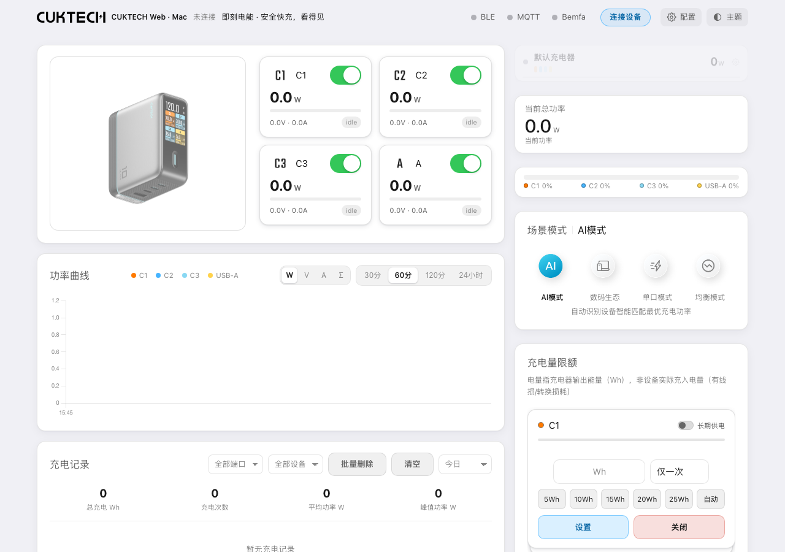

# 酷态站 · CUKTECH Station

通过 Mac 蓝牙连接兼容的酷态科充电器，在浏览器中查看端口功率、控制供电和管理充电记录。基于 [cuktech-ble-ha](https://github.com/kairui1108/cuktech-ble-ha) 改造，提供 macOS 安装脚本、后台启动器和本地数据管理。

> 当前发布的是 **Mac 本地版**：Mac 需要开机并保持唤醒。ESP32 与 Home Assistant 源码作为可选组件保留；ESP32 上传云端及独立远程网站尚未实现。



## 功能

- 使用米家 App 扫码获取并导入设备信息，支持多设备管理、重命名及移除。
- 通过 SSE 推送端口电压、电流、功率及蓝牙连接状态，提供桌面和手机布局、中英文及深浅主题。
- 控制端口、协议和场景，支持倒计时、充电限额等功能；可用能力取决于充电器型号和固件。
- 使用本地 SQLite 保存充电会话、功率曲线，支持查看和导出。
- 蓝牙断线重试与错误提示；提供启动、停止、状态查询及可选登录自启入口。
- 可选 MQTT / 巴法云 / Home Assistant 接入，Mac 本地使用无需启用。

## 环境与兼容性

- macOS 12.3+、可用的蓝牙，以及 Python 3.10+（推荐 3.11）。安装入口检测到 `uv` 时会准备 Python 3.11；否则需要先安装 [Python](https://www.python.org/downloads/macos/)。
- 首次安装依赖和米家扫码导入需要联网；日常设备通信使用蓝牙。
- 上游主要面向 CUKTECH 10 GaN Charger Ultra。其他型号能否使用相同 BLE 协议需要实测，不代表支持所有酷态科产品。
- 已有 Apple Silicon 启动器构建与软件测试记录；Intel、真实账号扫码、充电器认证与控制、ESP32 和真实 HA 实例的验证范围见 [验证说明](docs/改造与验证说明.md)。自动测试使用模拟设备，不能代替硬件验收。

## 从源码开始

下载仓库 ZIP 并解压，或执行：

```bash
git clone https://github.com/QianXinyu8888/cuktech-web-mac.git
cd cuktech-web-mac
bash macos/manage.sh install
bash macos/manage.sh run
```

也可双击 `安装环境.command`，完成后双击 `启动助手.command`。`.command` 启动时请保持终端打开。

服务就绪后会打开浏览器。默认地址：

- 控制页：<http://127.0.0.1:18299/>
- 配置页：<http://127.0.0.1:18299/config.html>

在配置页选择 **登录米家账号自动获取 → 获取二维码**，用米家 App 扫码并确认，勾选充电器后导入。导入会自动保存并重启；之后手动修改其他设置时，需要点击「保存配置并重启」。首次蓝牙授权请选择允许。

详细步骤和排障见 [图文说明](快速使用说明.md)。GitHub 不会直接渲染 [HTML 说明](快速使用说明.html)，下载后可在本机浏览器打开。

## 启动器与日常管理

仓库只提供启动器源码，**不包含 `CUKTECH Station.app` 二进制**。需要 Xcode 命令行工具，然后运行：

```bash
bash macos/build_app.sh
```

生成的应用包含 Intel / Apple Silicon 两种架构，采用本机 ad-hoc 签名，未经过 Apple 公证。请将应用保留在项目根目录；首次运行仍需安装 Python 环境。构建源码需要 Xcode 命令行工具，使用 `.command` 入口无需编译 Swift。

| 操作 | 入口 |
| --- | --- |
| 启动 / 停止 / 查看状态 | `启动助手.command` / `停止服务.command` / `查看状态.command` |
| 后台启动 | 构建后双击 `CUKTECH Station.app` |
| 登录自启 | `启用登录自启.command` / `取消登录自启.command` |
| 配置、充电历史、日志 | 首次运行后生成的 `runtime/` |

关闭网页不会停止服务；休眠、合盖和其他 App 占用蓝牙可能中断数据。蓝牙失败时先检查系统权限、距离，并退出手机或 Mac 上其他正在控制该充电器的程序。

移动项目后需重新创建 `.venv/` 并安装依赖。启用了登录自启时，先取消自启，再移动项目和重新启用。删除 `runtime/` 会丢失设备配置和充电历史；先停止服务再自行决定是否清空。

## 安全与隐私

默认仅监听 `127.0.0.1`。本地接口具备请求来源检查，**没有面向公网的用户认证和权限体系**；有权访问本机服务的程序仍可查看配置和控制设备。不要直接端口转发或通过公网隧道发布当前控制服务。局域网监听需自行配置网络隔离和访问保护。

设备 Token、BLE Key、MQTT 密码、米家账号信息和登录二维码都属于敏感信息。配置、历史与日志保存在本机；启用 MQTT / 巴法云后会向指定服务发送数据。日志与 CSV 导出可能暴露设备信息和使用习惯，提交 Issue 前请脱敏。

上传源码使用 Git 提交清单；`.gitignore` 不会清理普通 ZIP，也不会移除已经提交的秘密。运行 `python3 scripts/check_publication.py` 检查公开文件，用 `git archive` 生成源码包。更完整的发布清单见 [SECURITY.md](SECURITY.md)，本轮发现与处理见 [开源发布审查](docs/开源发布审查.md)。

## 开发与测试

```bash
uv pip install --python .venv/bin/python -e 'src/cuktech-ble-ha-main/ble_server[dev]'
.venv/bin/python -m pytest tests src/cuktech-ble-ha-main/ble_server/tests -q
.venv/bin/python -m pytest src/cuktech-ble-ha-main/ha_integration/tests -q
for file in src/cuktech-ble-ha-main/ble_server/tests/js/*_test.js; do
  node "$file" || break
done
python3 scripts/check_publication.py
```

没有 `uv` 时可使用虚拟环境的 `python -m pip install -e '…[dev]'`。测试分别运行，避免两套组件的 pytest 配置与测试替身相互影响。JS 测试需要 Node.js。GitHub Actions 会执行软件回归及公开文件检查，不接触真实账号或蓝牙。

| 目录 | 内容 |
| --- | --- |
| `macos/` | Swift 启动器、Python 监管进程、安装及登录自启管理 |
| `src/cuktech-ble-ha-main/ble_server/` | Python BLE 服务、浏览器界面与回归测试 |
| `src/cuktech-ble-ha-main/esp32_ble/` | 可选 ESP-IDF 固件；S3 支持仍需实机验证 |
| `src/cuktech-ble-ha-main/ha_integration/` | 可选 Home Assistant 集成及模拟测试 |
| `docs/` | 操作截图、改造记录与本次发布审查说明 |

## 来源、许可与限制

本项目是非官方社区工具，与酷态科、小米 / 米家无关联。源码保留上游 [MIT 许可](LICENSE)。第三方库和图片来源见 [THIRD_PARTY_NOTICES.md](THIRD_PARTY_NOTICES.md)。产品商标和第三方素材权利归原权利人；第三方图片未提供独立授权证明，不应假定可任意再许可或商用。

端口开关会中断供电。充电限额等自动化依赖进程持续运行与蓝牙连接，不应作为安全保护装置。欢迎提交可复现的问题及已脱敏的日志。
