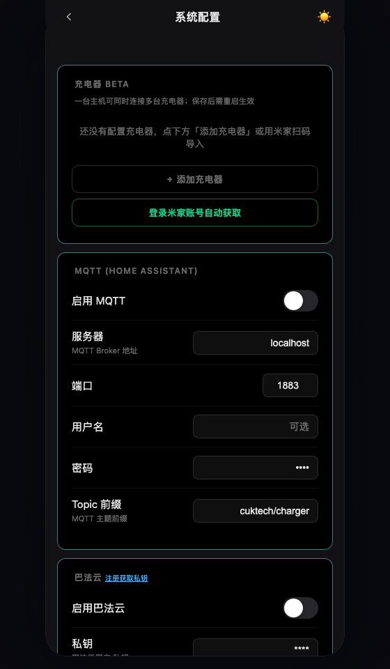
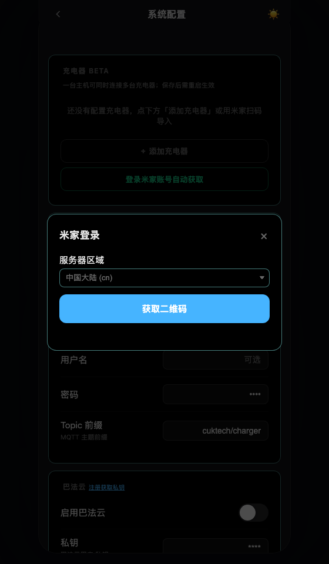
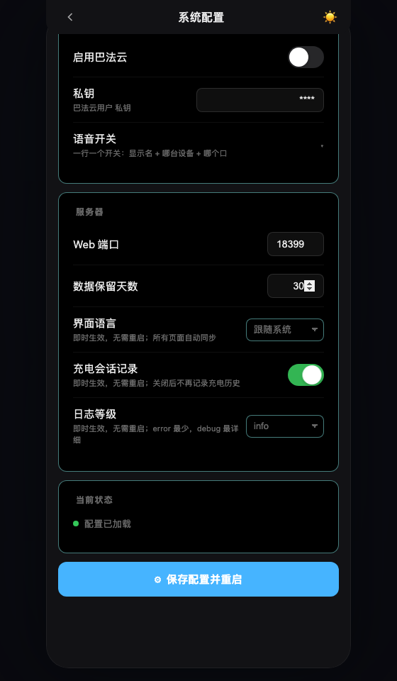
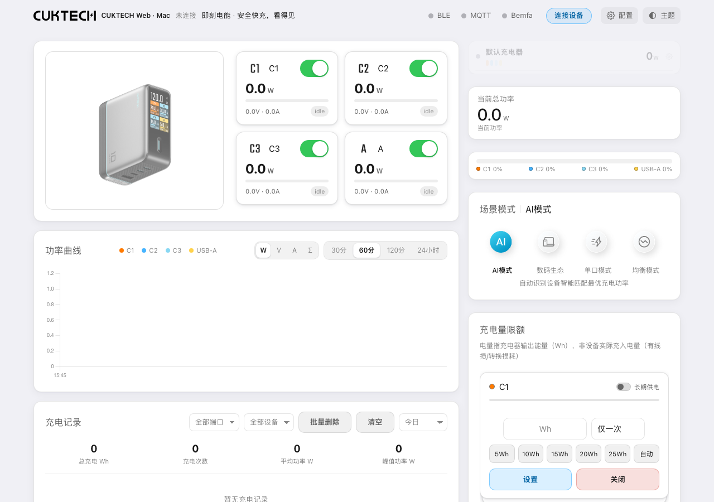

# 酷态站 快速使用说明

**第一次：安装 → 启动 → 米家扫码 → 导入 → 保存重启 → 使用。**

## 1. 准备设备

- 给充电器接通电源，放在 Mac 附近，打开 Mac 蓝牙。
- 手机安装米家 App，并用自己的账号添加这台充电器。
- 打开桌面 `cuktech-web-mac` 文件夹。

## 2. 安装环境

双击 **安装环境.command**。看到“安装完成”后关闭该窗口。

首次使用请运行安装入口；换电脑后需要重新安装。若提示缺少 Python，请先从 [官网](https://www.python.org/downloads/macos/) 安装 Python 3.11 或更新版本。

## 3. 启动助手

双击 **启动助手.command**。源码仓库不包含应用二进制；如需 **CUKTECH Station.app**，先运行 `bash macos/build_app.sh` 构建。

浏览器会自动打开配置页；未自动打开时访问：<http://127.0.0.1:18299/config.html>。

应用会在后台运行；若使用 `.command` 入口，**保持启动终端打开**。首次请求蓝牙权限时点击“允许”；误拒绝后，去“系统设置 → 隐私与安全性 → 蓝牙”，允许启动器、终端或实际运行的 Python，然后重新启动助手。

## 4. 用米家导入自己的充电器

1. 点击「充电器」卡片下方的 **登录米家账号自动获取**。
2. 选择与米家 App 一致的区域，国内账号通常选“中国大陆”。
3. 点击 **获取二维码**，打开手机米家 App 的扫一扫并确认登录。
4. 在手机上确认登录后，页面会自动进入设备清单；也可以点击 **已完成扫码** 立即查询。
5. 勾选充电器，点击弹窗底部的导入按钮；需要时勾选同步设备名称。
6. 导入成功会提示「已添加」，并自动保存、重启服务，随后自动回到主页。等主页恢复即可使用，不需要再手动保存。

## 5. 保存并连接

1. 导入的设备已经在导入时自动保存过了；卡片里的设备信息可以直接核对。
2. 只在 Mac 本机使用时，**MQTT 和巴法云保持关闭**。
3. 之后如果又改了 MQTT、巴法云或端口等设置，再滚到页面底部点击 **保存配置并重启**。
4. 等待页面恢复，再打开 <http://127.0.0.1:18299/>。
5. 退出手机米家中该设备的控制页、停止其他蓝牙控制程序，等待约 30–60 秒。若未自动连接，点击主页 **连接设备**。

**只有手动改过的其他设置才需要点保存。** 米家导入会自己保存；但改了 MQTT / 巴法云 / 端口后不保存，刷新页面会丢失。

## 管理设备和切换账号

- **改名字**：配置页找到设备 → 编辑 → 修改设备名称 → 保存配置并重启。主设备和附加设备都支持；清空名称会恢复默认名称。
- **删设备**：设备卡片 → 删除 → 确认 → 保存配置并重启。主设备可以删除，下一台自动接替；全部删除后页面恢复空白配置，可再次扫码导入或手动添加。
- **换账号**：登录米家账号自动获取 → 切换账号 → 选择区域 → 用另一个米家账号扫码。切换账号保留已添加的设备；删除设备只影响本项目，不会解绑米家中的设备。

## 6. 日常使用

| 想做什么 | 在哪里操作 |
| --- | --- |
| 查看每个端口功率 | 主页的 C1、C2、C3、A 卡片 |
| 开关某个端口 | 对应端口卡片右上角的开关 |
| 查看变化曲线 | 功率曲线区选择端口和时间范围 |
| 查看充电历史 | 充电记录区选择日期、端口，再点一条记录 |
| 导出一次充电的数据 | 记录详情中的“导出 CSV” |
| 设置自动关闭 | 倒计时区选择对应端口、输入分钟后点设置 |
| 修改账号或设备 | 主页“配置” → 米家导入 → 保存重启 |

图中“未连接”、0 W、暂无记录是全新配置的正常状态。连接自己的充电器后才会有实时读数。关闭端口会中断该端口供电，操作前请确认接的是哪台设备。

## 7. 结束使用

双击 **停止服务.command**，或在启动终端按 **Control+C**。关闭浏览器页面不会停止服务。

下次直接双击应用即可；无需再次安装或扫码，除非在米家里重新绑定设备导致凭据变化。记录期间保持 Mac 唤醒，合盖或休眠会影响连接与记录。

## 常见情况

| 情况 | 处理步骤 |
| --- | --- |
| 不能双击脚本 | 在终端输入 `bash `，把对应 `.command` 拖进终端，再按回车 |
| 提示缺少 Python | 安装 Python 3.11+，重新运行“安装环境” |
| 提示端口被占用 | 停止占用程序，或修改 `runtime/config.yaml` 的 `server.port`，重新启动；新地址可用“查看状态”查看 |
| 扫码后没有充电器 | 检查登录账号、服务器区域，以及设备是否已添加到该账号 |
| 长时间未连接 | 检查蓝牙授权、设备距离，退出其他控制程序，再停止并重新启动助手 |
| 页面不自动打开 | 运行“查看状态”，将显示的地址粘贴到浏览器 |

本机配置、历史和日志保存在首次运行后生成的 **runtime** 文件夹中，该目录不随源码发布。发布包不包含任何设备配置、账号、充电记录或运行日志。
